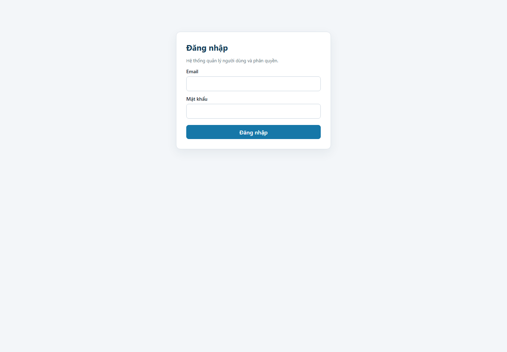
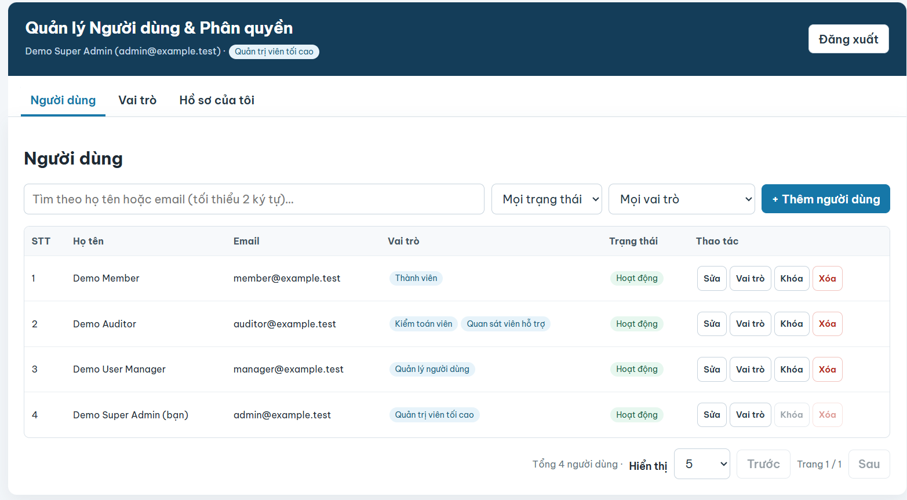
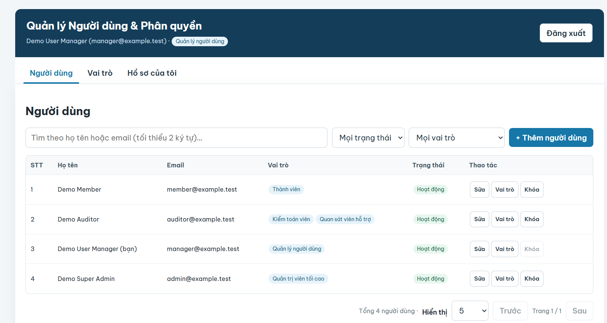
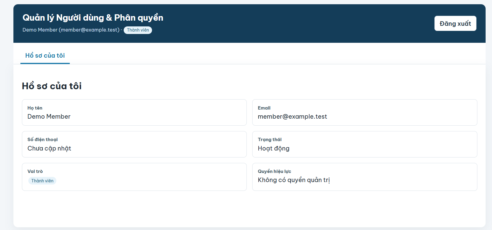

# ĐẠI HỌC BÁCH KHOA HÀ NỘI
## TRƯỜNG CÔNG NGHỆ THÔNG TIN VÀ TRUYỀN THÔNG

# BÁO CÁO CÁ NHÂN
## BÀI TẬP FULLSTACK – QUẢN LÝ NGƯỜI DÙNG VÀ PHÂN QUYỀN RBAC

Học phần: Công nghệ Web và Dịch vụ trực tuyến (IT4409)

| Thông tin | Nội dung |
|---|---|
| Họ và tên | Phạm Quang Anh |
| MSSV | 20252292M |
| Lớp / Mã lớp học |IT4409 / IT4409-1-26 (26.1A01) |
| Email sinh viên | [anh.pq252292M@sis.hust.edu.vn] |
| Nhóm BTL (nếu có) | 1 thành viên |
| Giảng viên | Nguyễn Mạnh Tuấn |
| Ngày nộp | 29/10/2026 |

## MỤC LỤC

1. Thông tin nộp bài  
   1.1. Đường dẫn  
   1.2. Tài khoản để giảng viên kiểm tra trên bản online  
   1.3. Môi trường  
2. Tổng quan kết quả  
   2.1. Bảng hoàn thành chức năng  
   2.2. Tóm tắt  
3. Quá trình phát triển  
   3.1. Nhật ký thực hiện  
   3.2. Lịch sử commit  
   3.3. Cấu trúc thư mục thực tế  
4. Kiến trúc và thiết kế đã hiện thực  
   4.1. Sơ đồ triển khai  
   4.2. Khác biệt so với đề bài  
   4.3. Bản đồ endpoint → mã nguồn  
5. Triển khai online  
   5.1. Lựa chọn nền tảng  
   5.2. Biến môi trường trên host  
   5.3. Các bước triển khai  
   5.4. Sự cố khi triển khai  
   5.5. Số liệu đo trên bản online  
6. Minh họa kết quả  
   6.1. Ảnh giao diện theo vai trò  
   6.2. Video demo  
7. Kiểm thử  
   7.1. Kết quả API T01–T24 trên bản online  
   7.2. Các test chưa đạt  
   7.3. Kiểm tra phân quyền qua API  
8. Phân tích và giải thích  
9. Khai báo sử dụng AI  
10. Tự đánh giá và bài học  
Cam kết

# 1. Thông tin nộp bài

## 1.1. Đường dẫn

| Hạng mục | Đường dẫn | Ghi chú |
|---|---|---|
| Repository mã nguồn | https://github.com/RoyalAnh/Web_and_Services/tree/master/Ex3-RBAC | Public, nhánh `master` |
| Commit mã nguồn RBAC | https://github.com/RoyalAnh/Web_and_Services/commit/e8f5e696c35a1a942f383e85df439fbcd1055286 | Chứa toàn bộ project trong folder `Ex3-RBAC` |
| Commit bổ sung video và evidence | https://github.com/RoyalAnh/Web_and_Services/commit/7f7df720d37241c43376de86e6c6e29f7482d612 | Bổ sung video demo và ảnh giao diện vào `Ex3-RBAC/report/evidence` |
| Commit xóa folder tên cũ | https://github.com/RoyalAnh/Web_and_Services/commit/bee198c1104494ffdad75099a1da2c7e65ea32fc | Chỉ xóa folder trùng `Ex3-RBAC-2025229M-PhamQuangAnh` |
| Frontend tĩnh (bản online) | https://www.pqahust.dev/Ex3-RBAC/frontend/index.html | GitHub Pages HTTP 200; tải được trang đăng nhập |
| Backend – Base URL | https://web-and-services-rbac.onrender.com | Render service live; health, unauthenticated authorization, and CORS preflight checked |
| Postman collection | `Ex3-RBAC/postman/RBAC-T01-T24.postman_collection.json` | Collection Runner online đạt 24/24; kiểm tra độc lập HTTP harness cũng đạt 24/24 |
| Video demo | [Xem demo.mp4 trên GitHub](https://github.com/RoyalAnh/Web_and_Services/blob/master/Ex3-RBAC/report/evidence/demo.mp4?raw=true) | Minh họa đăng nhập các tài khoản seed và xem giao diện/quyền |

## 1.2. Tài khoản để giảng viên kiểm tra trên bản online

Đã seed bốn tài khoản demo vào MongoDB Atlas và xác minh đăng nhập online cùng quyền hiệu lực. Mật khẩu không ghi trong báo cáo; sẽ cung cấp riêng qua kênh an toàn nếu giảng viên yêu cầu.

| Vai trò | Email | Quyền hiệu lực (qua `/me`) |
|---|---|---|
| super-admin | `admin@example.test` | 10 quyền (toàn bộ) |
| user-manager | `manager@example.test` | 6 quyền |
| auditor | `auditor@example.test` | 3 quyền |
| member | `member@example.test` | 0 quyền |

## 1.3. Môi trường

| Thành phần | Phiên bản / Dịch vụ |
|---|---|
| Node.js (máy phát triển) | v22.20.0 |
| Express / Mongoose | Express 5.3.0; Mongoose 8.24.6 (đã cài và kiểm thử local) |
| Các dependency backend còn lại | bcryptjs 2.4.3; cors 2.8.6; dotenv 16.6.1; jsonwebtoken 9.0.3 |
| CSDL | MongoDB Atlas Free; API startup đã kết nối Atlas |
| Nơi chạy Backend | Render Web Service: `https://web-and-services-rbac.onrender.com`; deploy live thành công |
| Nơi chạy Frontend | GitHub Pages tại URL ở mục 1.1; source config dùng API Render trên host non-local |
| Lệnh khởi chạy | `cd backend; npm start` |
| Lệnh kiểm thử | `cd backend; npm test` |

# 2. Tổng quan kết quả

## 2.1. Bảng hoàn thành chức năng

| # | Chức năng | Trạng thái | Ghi chú |
|---:|---|---|---|
| 1 | Đăng nhập POST /auth/tokens, GET /me | Hoàn thành | Bốn tài khoản demo đăng nhập HTTP 200; `/me` xác nhận đúng vai trò và quyền; JWT chỉ chứa `sub` cùng thời gian phát hành/hết hạn |
| 2 | Middleware authenticate, requirePermission ở mọi endpoint | Hoàn thành  | Mỗi API trừ login yêu cầu token; quyền lấy lại từ MongoDB từng request |
| 3 | GET /users: tìm kiếm, lọc, sắp xếp, phân trang | Hoàn thành | Tìm theo tên/email có escape regex; lọc trạng thái/vai trò; `Promise.all` cho danh sách và tổng |
| 4 | POST /users | Hoàn thành | Allow-list, mật khẩu mạnh, mặc định member, kiểm tra roles:assign và chống leo thang |
| 5 | PATCH /users/:userId | Hoàn thành | Chỉ cập nhật trường gửi; status active/locked; tự khóa bị cấm; bảo vệ super-admin cuối |
| 6 | DELETE /users/:userId | Hoàn thành | Xóa mềm; giữ email để không tái sử dụng; cấm tự xóa |
| 7 | Gán / gỡ vai trò | Hoàn thành  | PUT/DELETE idempotent; chống leo thang; cấm tự gỡ; bảo vệ super-admin cuối |
| 8 | CRUD vai trò, thay bộ quyền | Hoàn thành| Vai trò hệ thống và vai trò đang sử dụng được bảo vệ |
| 9 | GET /permissions, GET /roles/:roleId/permissions | Hoàn thành | Chỉ đọc danh mục quyền |
| 10 | Định dạng lỗi thống nhất, đúng mã trạng thái | Hoàn thành  | Có mã ổn định, thông điệp và details khi cần; không lộ stack trace |
| 11 | Frontend: đăng nhập, Axios interceptor, 401 | Hoàn thành mã nguồn | Token sessionStorage; chuẩn hóa lỗi, xử lý hết hạn tập trung |
| 12 | Frontend: hiển thị theo quyền | Hoàn thành mã nguồn | Ẩn tab/nút theo `me.permissions`; quyền vẫn được kiểm tra tại backend |
| 13 | Frontend: trang Người dùng, modal Thêm/Sửa, Gán vai trò | Hoàn thành mã nguồn | Tìm kiếm debounce, lọc, phân trang, validation, Promise.allSettled khi gán/gỡ |
| 14 | Frontend: trang Vai trò, modal Vai trò | Hoàn thành mã nguồn | Quyền nhóm theo resource; disable quyền vượt mức, khóa checkbox vai trò hệ thống |
| 15 | Responsive (màn hình < 768px) | Hoàn thành mã nguồn | Bảng cuộn ngang, modal 95%, nút thao tác tối thiểu 44px |
| 16 | Triển khai online (Frontend + Backend + CSDL) | Hoàn thành deployment cơ bản | GitHub Pages + Render + MongoDB Atlas; bốn vai trò demo đã login và xác minh quyền; Postman T01–T24 đạt |
| 17 | Phần mở rộng | Một phần | Seed có vai trò tùy chỉnh `support-observer`; chưa có dữ liệu cá nhân/nhóm thật |

## 2.2. Tóm tắt

Đã tạo ứng dụng RBAC gồm API Express 5/Mongoose và giao diện React/Axios responsive trong folder `Ex3-RBAC`. Backend có 18 endpoint theo đặc tả, xác thực JWT, hash bcrypt, các vai trò hệ thống, phân quyền theo mã permission và response không chứa `passwordHash`. Bộ kiểm thử local đạt 38/38. Frontend được GitHub Pages phục vụ; API chạy trên Render và kết nối MongoDB Atlas. Đã xác minh API health trả HTTP 200, endpoint bảo vệ trả 401 nếu thiếu token, CORS preflight từ origin frontend trả 204, và bốn tài khoản demo đăng nhập thành công với đúng quyền super-admin, user-manager, auditor, member. Báo cáo có ảnh ba vai trò và video demo. 24 kịch bản HTTP tương ứng T01–T24 đã được kiểm tra độc lập trên host và đạt 24/24; Collection Runner cũng đạt 24/24.

# 3. Quá trình phát triển

## 3.1. Nhật ký thực hiện

Nhật ký mô tả các đầu việc theo ngày; tổng thời gian làm project và viết báo cáo là 10 giờ, gồm 1 giờ hoàn thiện cuối ngày 28/10/2026.

| Ngày | Công việc | Thời gian (giờ) | Commit | Khó khăn gặp phải |
|---|---|---:|---|---|
| 21/10/2026 | Đọc PDF 44 trang, đối chiếu template MD/DOCX | 1 | `e8f5e696` | Hơi rối lúc đầu, phải đọc kĩ |
| 21/10/2026 | Tạo backend, frontend, test và Postman trong project RBAC | 2 | `e8f5e696` | Lúc phát triển chưa có backend host |
| 22/10/2026 | Xóa folder trùng tên cũ khỏi nhánh `master` | 0.5 | `bee198c1104494ffdad75099a1da2c7e65ea32fc` | |
| 26/10/2026 | Cấu hình Render/Atlas và khởi chạy API online | 2 | Deploy từ `6002ff3da3e6c9a1ae7d57f741c5ce01412214e6` | Bổ sung `MONGODB_URI` và cấu hình Atlas Network Access |
| 26/10/2026 | Cấu hình frontend dùng API Render | 1 | `fdd3c285c94320d20a4e64cbbaf1fd833cae1694` | Pages config được xác minh đã cập nhật |
| 26/10/2026 | Cập nhật tài liệu theo kiểm tra trực tiếp API/CORS và Pages | 2 | `152f271afaddb5ea9e929af9af2ad8b0b7e748b3` | Postman online còn cần kiểm tra |
| 26/10/2026 | Seed bốn tài khoản demo và xác minh login/quyền trên API online | 0.5 | Thao tác dữ liệu Atlas; không tạo commit | Không ghi credentials; xác minh role/permission qua `/me` |
| 28/10/2026 | Hoàn thiện báo cáo, đồng bộ DOCX, đưa video và ảnh minh họa lên GitHub | 1 | `7f7df720d37241c43376de86e6c6e29f7482d612` | Rà soát đường dẫn video và bằng chứng trước khi nộp |
|  | **Tổng thời gian** | **10 giờ (gồm làm project và viết báo cáo)** |  |  |

## 3.2. Lịch sử commit

Các commit liên quan đã xác minh trên GitHub:

```text
e8f5e696c35a1a942f383e85df439fbcd1055286  RBAC
bee198c1104494ffdad75099a1da2c7e65ea32fc  Remove obsolete RBAC folder name
d4e84bdca7da5cb7c613095ab626590afda5359e  Prepare RBAC project for Render deployment
6002ff3da3e6c9a1ae7d57f741c5ce01412214e6  Update deployment safeguard status
fdd3c285c94320d20a4e64cbbaf1fd833cae1694  Connect hosted RBAC frontend to Render API
152f271afaddb5ea9e929af9af2ad8b0b7e748b3  Record verified hosted RBAC integration
7f7df720d37241c43376de86e6c6e29f7482d612  Publish final RBAC demo evidence
```

Render hiện chạy từ commit `6002ff3...`; commit `fdd3c28...` nối frontend với API Render. Commit hoàn thiện cuối bổ sung video/ảnh evidence và cập nhật báo cáo; không thay đổi mã backend đang deploy.

## 3.3. Cấu trúc thư mục thực tế

```text
Ex3-RBAC/
├── .env.example
├── .gitignore
├── README.md
├── backend/
│   ├── app.js
│   ├── server.js
│   ├── seed.js
│   ├── package.json
│   ├── package-lock.json
│   ├── middleware/auth.js
│   ├── models/{Permission,Role,User}.js
│   ├── routes/{auth,users,roles,permissions}.js
│   ├── utils/{http,rbac}.js
│   └── test/{api,http}.test.js
├── docs/deployment.md
├── frontend/
│   ├── config.js
│   └── index.html
├── postman/RBAC-T01-T24.postman_collection.json
└── report/
    ├── evidence/{admin,frontend-login,manager,member}.png
    ├── evidence/demo.mp4
    ├── build_docx.py
    ├── final_completion_checklist.md
    └── test-results.md
```

# 4. Kiến trúc và thiết kế đã hiện thực

## 4.1. Sơ đồ triển khai

```text
Trình duyệt (React/Axios)
        | HTTPS
        v
GitHub Pages (frontend tĩnh) ---> Render Web Service (Express API)
                                                |
                                                v
                                      MongoDB Atlas
```

**Hình 1.** Luồng triển khai: trình duyệt tải frontend từ GitHub Pages, gọi API trên Render; API kết nối MongoDB Atlas.

## 4.2. Khác biệt so với đề bài

| # | Đặc tả trong đề | Đã làm | Lý do |
|---:|---|---|---|
| 1 | Dùng `FIELD_NOT_ALLOWED` trong test T11; phụ lục mô tả lỗi field như validation detail | Field không cho phép trả HTTP 400, top-level `FIELD_NOT_ALLOWED` và detail cùng issue; các validation khác trả `VALIDATION_ERROR` | Ưu tiên test case T11 tường minh; đây là khác biệt nội bộ giữa bảng test và mô tả/phụ lục PDF |
| 2 | Hướng dẫn có thể xóa dữ liệu khi seed | Seed hiện upsert, không xóa collection và không ghi đè mật khẩu hiện có | Bảo vệ dữ liệu; dùng DB riêng khi seed/test |
| 3 | Triển khai online và dữ liệu chính xác | GitHub Pages + Render API + MongoDB Atlas đã chạy; bốn vai trò demo login đã xác minh | Tách static frontend/API/database; Render Free có thể cold start |
| 4 | — | Thêm `GET /health` ngoài `/api/v1` | Kiểm tra sức khỏe host; không cấp quyền truy cập tài nguyên RBAC |

## 4.3. Bản đồ endpoint → mã nguồn

 Route handlers nằm tại các file sau; mọi route dưới users/roles/permissions được bảo vệ bằng authenticate và permission tương ứng.

| Endpoint | Vị trí trong mã nguồn | Permission kiểm tra |
|---|---|---|
| POST /auth/tokens | `backend/routes/auth.js` | Công khai |
| GET /me | `backend/routes/auth.js` | Đã đăng nhập |
| GET /users | `backend/routes/users.js` | `users:read` |
| POST /users | `backend/routes/users.js` | `users:create`; `roles:assign` nếu chỉ định roleIds |
| GET /users/:userId | `backend/routes/users.js` | `users:read` |
| PATCH /users/:userId | `backend/routes/users.js` | `users:update` |
| DELETE /users/:userId | `backend/routes/users.js` | `users:delete` |
| GET /users/:userId/roles | `backend/routes/users.js` | `users:read` |
| PUT /users/:userId/roles/:roleId | `backend/routes/users.js` | `roles:assign` |
| DELETE /users/:userId/roles/:roleId | `backend/routes/users.js` | `roles:assign` |
| GET /roles | `backend/routes/roles.js` | `roles:read` |
| POST /roles | `backend/routes/roles.js` | `roles:create` |
| GET /roles/:roleId | `backend/routes/roles.js` | `roles:read` |
| PATCH /roles/:roleId | `backend/routes/roles.js` | `roles:update` |
| DELETE /roles/:roleId | `backend/routes/roles.js` | `roles:delete` |
| GET /roles/:roleId/permissions | `backend/routes/roles.js` | `roles:read` |
| PUT /roles/:roleId/permissions | `backend/routes/roles.js` | `roles:update` |
| GET /permissions | `backend/routes/permissions.js` | `permissions:read` |

# 5. Triển khai online

## 5.1. Lựa chọn nền tảng

| Câu hỏi | Trả lời |
|---|---|
| Bạn chọn nền tảng nào cho Backend, Frontend, CSDL? Vì sao? Gói miễn phí có giới hạn gì và bạn xử lý thế nào? | Frontend dùng GitHub Pages; Backend dùng Render Web Service; database dùng MongoDB Atlas Free. Cấu hình tách static frontend/API/database, phù hợp demo. Render Free có thể sleep khi idle và cold-start chậm; Atlas Free giới hạn tài nguyên/dung lượng. Đây không phải cấu hình production cho dữ liệu quan trọng; cần theo dõi giới hạn hiện hành trên dashboard nhà cung cấp. |

## 5.2. Biến môi trường trên host

| Tên biến | Mục đích | Giá trị ở local khác ở host thế nào? |
|---|---|---|
| `MONGODB_URI` | URI database riêng | Local MongoDB hoặc Atlas test; host dùng URI Atlas secret |
| `JWT_SECRET` | Ký/xác thực access token | Tách biệt, ngẫu nhiên mạnh, không dùng chung |
| `ACCESS_TOKEN_TTL` | Thời hạn access token (giây) | Mặc định 3600; xác minh cấu hình thật |
| `PORT` | Cổng HTTP backend | Local 3001; host dùng cổng do nền tảng cấp |
| `CORS_ORIGINS` | Allow-list chính xác các frontend origin | Host cho phép `https://www.pqahust.dev`; xác minh bằng OPTIONS preflight |
| `NODE_ENV` | Chế độ runtime | `development` local, `production` trên host |
| `SEED_*_EMAIL`, `SEED_*_NAME` | Tài khoản mẫu không bí mật | Chỉ dùng dữ liệu người được phép |
| `SEED_*_PASSWORD` | Mật khẩu seed; chỉ dùng bí mật tạm thời | Xóa khỏi runtime sau khi tạo tài khoản |

## 5.3. Các bước triển khai

Frontend tĩnh được GitHub Pages phục vụ tại `https://www.pqahust.dev/Ex3-RBAC/frontend/index.html`. Backend chạy trên Render `https://web-and-services-rbac.onrender.com`; deploy thành công. API startup kết nối MongoDB Atlas; `/health` trả HTTP 200. Bản frontend dùng API Render đã được push và xác minh trên Pages.
 
Pages UI tại `https://www.pqahust.dev/Ex3-RBAC/frontend/index.html` (HTTP 200) được Pages phục vụ với API base `https://web-and-services-rbac.onrender.com/api/v1`; trình duyệt tải giao diện đăng nhập. Backend đã chạy trên Render; MongoDB Atlas connect thành công khi service khởi động. `GET /health` trả HTTP 200 với `{"status":"ok"}`; `GET /api/v1/users` không token trả HTTP 401. OPTIONS từ origin `https://www.pqahust.dev` trả HTTP 204 với `Access-Control-Allow-Origin: https://www.pqahust.dev`, methods `GET,POST,PUT,PATCH,DELETE,OPTIONS`, headers `Authorization,Content-Type`, expose header `Location`, max-age `600`, và `Vary: Origin`. OPTIONS từ `https://example.com` không có `Access-Control-Allow-Origin`. Bốn tài khoản `admin@example.test`, `manager@example.test`, `auditor@example.test`, `member@example.test` đã được seed vào Atlas; mỗi tài khoản đăng nhập trả HTTP 200, `/me` trả HTTP 200 và xác nhận đúng role/quyền (10, 6, 3, 0 permissions). Password hashes đã được cập nhật từ bốn mật khẩu riêng, mạnh trong file môi trường cục bộ; không ghi các giá trị đó trong báo cáo. 24 kịch bản HTTP tương ứng T01–T24 đã được kiểm tra độc lập với API online đạt 24/24. Đã chạy Postman collection online và tất cả test đều đạt.

Giao diện đăng nhập frontend trên Pages:



**Hình 2.** Màn hình đăng nhập tại `https://www.pqahust.dev/Ex3-RBAC/frontend/index.html`; ảnh chụp trang công khai, chưa đăng nhập.

## 5.4. Sự cố khi triển khai

Quá trình triển khai gặp lỗi cấu hình thật: thiếu `MONGODB_URI`, sau đó Atlas từ chối kết nối do IP Render chưa được allowlist. Sau khi cấu hình environment variable và Atlas Network Access, Render khởi động thành công. Trước khi xác minh tài khoản demo, kiểm tra cục bộ phát hiện các giá trị seed ban đầu chưa đủ mạnh/riêng biệt; đã thay bằng bốn mật khẩu riêng, rồi kiểm tra lại login thành công. Không lưu mật khẩu trong báo cáo.

| Hạng mục | Nội dung |
|---|---|
| Triệu chứng (thông báo lỗi nguyên văn) | `MONGODB_URI is required`; sau đó `Could not connect to any servers in your MongoDB Atlas cluster... IP ... isn't whitelisted` |
| Cách tìm nguyên nhân | Đọc Render deploy/runtime logs và phân biệt lỗi thiếu env với Atlas Network Access |
| Nguyên nhân gốc | Thiếu biến môi trường trên Render; IP outbound của Render chưa được Atlas cho phép |
| Cách sửa (commit/cấu hình) | Cấu hình `MONGODB_URI` trên Render và cho phép kết nối phù hợp trong Atlas Network Access; deploy sau đó báo live |

## 5.5. Số liệu đo trên bản online

Đo API qua phiên super-admin đã đăng nhập trong trình duyệt ngày 28/10/2026 khoảng 22:17 (giờ Việt Nam). Thời gian đăng nhập lấy từ Resource Timing của request login vừa hoàn thành; GET `/users` đo bằng `fetch` có header `Authorization` và `cache: "no-store"`, chạy ba lần cho mỗi limit và lấy trung vị. Đây là phép đo từ trình duyệt/mạng tại thời điểm đó, không phải benchmark tải.

| Phép đo | Kết quả | Thời điểm đo |
|---|---|---|
| Request đầu tiên sau >15 phút không truy cập: `GET /health` | HTTP 200; **22.612063 giây** | 28/10/2026, 22:35:43 ICT; request đầu sau ít nhất 15 phút không gọi API |
| POST `/auth/tokens` đăng nhập thành công | HTTP 200; 0.9489 giây (Resource Timing) | 28/10/2026, khoảng 22:17 ICT |
| GET `/users?page=1&limit=10` có xác thực | HTTP 200; các lần đo 410.9, 359.9, 338.8 ms; trung vị **359.9 ms**; 4 bản ghi | 28/10/2026, khoảng 22:17 ICT |
| GET `/users?page=1&limit=100` có xác thực | HTTP 200; các lần đo 349.7, 341.8, 327.3 ms; trung vị **341.8 ms**; 4 bản ghi | 28/10/2026, khoảng 22:17 ICT |
| Một CORS preflight OPTIONS tới `/api/v1/users` | HTTP 204; 0.382207 giây bằng curl chủ động. Trên browser đã mở Users và khóa rồi mở khóa tài khoản member; member được xác minh trở lại trạng thái active. Công cụ đo browser không ghi nhận được preflight OPTIONS nên không kết luận số OPTIONS của chuỗi UI này | OPTIONS chủ động: 28/10/2026, khoảng 22:02 ICT; thao tác UI: khoảng 22:36 ICT |

| Nhận xét số liệu limit/preflight |
|---|
| Request health đầu tiên sau thời gian idle mất khoảng 22.61 giây, phù hợp với độ trễ khởi động lại service miễn phí nhưng là một lần đo nên không đại diện cho mọi lần cold start. Cả hai truy vấn users trả 4 bản ghi; chênh lệch trung vị khoảng 18.1 ms trong lần đo này, không đủ để kết luận limit=100 nhanh hơn vì tập dữ liệu nhỏ và số lần đo ít. Thời gian login 0.9489 giây là một request đơn lẻ. Cấu hình có `Access-Control-Max-Age: 600`; OPTIONS chủ động trả 204. Đã thực hiện chuỗi UI mở Users, khóa rồi mở khóa member; xác minh member đang active sau kiểm tra. |

# 6. Minh họa kết quả

Dưới đây là ba ảnh giao diện sau đăng nhập bằng **ba vai trò khác nhau**. Ảnh trang đăng nhập ở mục 5.3 chỉ minh họa trang công khai, không tính vào ba ảnh theo vai trò.

## 6.1. Ba ảnh giao diện theo vai trò



**Hình 3.** Đăng nhập thành công bằng tài khoản super-admin.



**Hình 4.** Trang Người dùng khi đăng nhập bằng user-manager.



**Hình 5.** Member chỉ thấy hồ sơ cá nhân, không có quyền quản trị.

## 6.2. Video demo

Video demo minh họa đăng nhập các tài khoản seed và xem giao diện/quyền tương ứng: [Xem video demo trên GitHub](https://github.com/RoyalAnh/Web_and_Services/blob/master/Ex3-RBAC/report/evidence/demo.mp4?raw=true).

# 7. Kiểm thử

## 7.1. Kết quả kiểm thử API T01–T24 trên bản online

Collection `postman/RBAC-T01-T24.postman_collection.json` có 24 request và assertion status/error code. Bảng dưới ghi kết quả integration test local (cột Local) và kiểm tra HTTP trực tiếp với API online (cột Online). Collection Runner cũng đạt 24/24.

| # | Kỳ vọng (theo đề) | Kết quả thực tế (local) | Local | Online |
|---:|---|---|:---:|:---:|
| T01 | 401 UNAUTHENTICATED | 401 UNAUTHENTICATED | PASS | PASS |
| T02 | 403 FORBIDDEN | 403 FORBIDDEN | PASS | PASS |
| T03 | 200, meta đúng | 200, kiểm tra page/limit/data | PASS | PASS |
| T04 | 200, chỉ bản ghi khớp | 200, kiểm tra name/email + active | PASS | PASS |
| T05 | 400 INVALID_QUERY_PARAMETER | 400 INVALID_QUERY_PARAMETER | PASS | PASS |
| T06 | 201, có Location, không có passwordHash | 201, Location đúng, hash không có response | PASS | PASS |
| T07 | 409 EMAIL_ALREADY_EXISTS | 409 EMAIL_ALREADY_EXISTS | PASS | PASS |
| T08 | 400, WEAK_PASSWORD | 400, details issue WEAK_PASSWORD | PASS | PASS |
| T09 | 403 PRIVILEGE_ESCALATION | 403 PRIVILEGE_ESCALATION | PASS | PASS |
| T10 | 200, trường khác giữ nguyên | 200, fullName giữ nguyên sau PATCH phone | PASS | PASS |
| T11 | 400 FIELD_NOT_ALLOWED | 400 FIELD_NOT_ALLOWED và details cùng issue | PASS | PASS |
| T12 | 403 SELF_ACTION_FORBIDDEN | 403 SELF_ACTION_FORBIDDEN | PASS | PASS |
| T13 | 204, 204, không trùng | Hai lần 204, một role ID duy nhất | PASS | PASS |
| T14 | 403 PRIVILEGE_ESCALATION | 403 PRIVILEGE_ESCALATION | PASS | PASS |
| T15 | 403 ngay sau khi gỡ vai trò | 204 khi gỡ; token cũ nhận 403 ngay request tiếp | PASS | PASS |
| T16 | 403 FORBIDDEN | 403 FORBIDDEN | PASS | PASS |
| T17 | 204; GET 404; login 401 | Đã kiểm tra đủ ba hành vi | PASS | PASS |
| T18 | 404 USER_NOT_FOUND | 404 USER_NOT_FOUND với ID sai định dạng | PASS | PASS |
| T19 | 409 ROLE_CODE_EXISTS | 409 ROLE_CODE_EXISTS | PASS | PASS |
| T20 | 409 SYSTEM_ROLE_PROTECTED | 409 SYSTEM_ROLE_PROTECTED | PASS | PASS |
| T21 | 409 ROLE_IN_USE | 409 ROLE_IN_USE | PASS | PASS |
| T22 | 400 PERMISSION_NOT_FOUND | 400 PERMISSION_NOT_FOUND | PASS | PASS |
| T23 | 403 dù có X-User-Role | 403 FORBIDDEN | PASS | PASS |
| T24 | 400 MALFORMED_JSON | 400 MALFORMED_JSON | PASS | PASS |

Đã chạy riêng 24 kịch bản HTTP tương ứng T01–T24 trực tiếp với API Render bằng tài khoản và dữ liệu thử dùng một lần: **24/24 PASS**. Các ca tạo/xóa người dùng và gỡ vai trò dùng tài khoản thử riêng; dữ liệu thử đã được dọn, sau đó bốn tài khoản demo chính được đăng nhập và xác minh lại. Collection Runner T01–T24 trên bản online đạt toàn bộ test. Kết quả Runner và kết quả 24/24 của HTTP harness được kiểm tra độc lập.

## 7.2. Các test chưa đạt

Không có test nào thất bại trong lần chạy hiện tại. Backend automated tests chạy lại ngày 28/10/2026 đạt 38/38 PASS, không có test bị bỏ qua. Frontend tĩnh online trả HTTP 200. API online health trả 200, endpoint được bảo vệ trả 401 nếu thiếu token, CORS preflight trả 204, bốn tài khoản demo đăng nhập thành công với đúng role/quyền qua `/me`, và 24 kịch bản API tương ứng T01–T24 đạt 24/24 qua kiểm tra HTTP trực tiếp. Một lần chạy thử ban đầu có test nội bộ gửi `q` một ký tự nhưng kỳ vọng thành công; test fixture được sửa theo ràng buộc tối thiểu hai ký tự rồi chạy lại, không xóa assertion. Chi tiết và giới hạn bằng chứng ở `Ex3-RBAC/report/test-results.md`.

## 7.3. Kiểm tra phân quyền qua API

Các test T02 và T16 kiểm tra truy cập API bằng tài khoản không đủ quyền: member bị từ chối đọc danh sách người dùng, còn user-manager bị từ chối xóa người dùng; cả hai trả 403 `FORBIDDEN` theo kỳ vọng. Hai kịch bản tương ứng cũng nằm trong kiểm tra HTTP online được ghi tại `Ex3-RBAC/report/test-results.md`.

**Ý nghĩa của việc ẩn nút trên giao diện:** member không thấy nút "+ Thêm người dùng" nhưng vẫn gọi được API bằng `fetch`/Postman. Việc ẩn nút chỉ cải thiện trải nghiệm; ranh giới bảo mật nằm ở `authenticate` + `requirePermission` của Backend, nơi quyền được tra lại từ CSDL ở mỗi request và không tin bất kỳ thông tin phân quyền nào do client gửi (BR-07, BR-09, T23).

# 8. Phân tích và giải thích

Các dẫn chứng mã nguồn dưới đây dùng số dòng trong phiên bản hiện tại của project. Những nhận xét về trải nghiệm cá nhân và ảnh chụp không có trong thư mục evidence cần được tác giả rà soát trước khi nộp.

## Câu 1. Lần theo một request qua mã nguồn của bạn

Request: `PUT /api/v1/users/:userId/roles/:roleId` bằng token user-manager, gán vai trò `auditor`.

| Thứ tự | Hàm / middleware | Vị trí (file:dòng) | Việc nó làm với request này |
|---:|---|---|---|
| 1 | `cors(...)` | `backend/app.js:17-24` | Kiểm tra origin theo `CORS_ORIGINS`, cấu hình methods/headers; middleware CORS trả preflight OPTIONS. |
| 2 | `express.json({ limit: "100kb" })` | `backend/app.js:26` | PUT này không có body nên đi qua; JSON sai định dạng được chuẩn hóa thành `MALFORMED_JSON` tại `backend/utils/http.js:120-121`. |
| 3 | Mount `app.use("/api/v1/users", ...)` | `backend/app.js:30` | Chuyển request vào router users. |
| 4 | `router.use(authenticate)` | `backend/routes/users.js:29`; `backend/middleware/auth.js:5-32` | Xác minh JWT, nạp user theo `sub` cùng các role, từ chối user không tồn tại/bị khóa và tính hợp quyền vào `req.permissions`. |
| 5 | `requirePermission("roles:assign")` | `backend/middleware/auth.js:36-44`; route tại `backend/routes/users.js:150` | User-manager có `roles:assign` nên đi tiếp; thiếu quyền thì trả 403 `FORBIDDEN`. |
| 6 | `loadUser` | `backend/routes/users.js:31-37` | Kiểm tra ObjectId, tìm user chưa xóa mềm và gắn vào `req.target`; không có thì 404 `USER_NOT_FOUND`. |
| 7 | `loadRole` | `backend/routes/users.js:40-45` | Tìm vai trò theo ObjectId và gắn vào `req.targetRole`; không có thì 404 `ROLE_NOT_FOUND`. |
| 8 | Handler `PUT` + `assertNoEscalation` | `backend/routes/users.js:150-158`; `backend/utils/rbac.js:62-74` | So quyền của role `auditor` với quyền người gọi; nếu không vượt quyền, chỉ thêm role khi chưa có rồi lưu user và trả 204. |

Không thêm `console.log` tạm để chụp quyền vì có thể làm lộ thông tin runtime. Danh sách quyền của các tài khoản demo được kiểm tra qua `/me`; test online tương ứng T13-T15 được ghi tại mục 7.1.

**Nếu thay `auditor` bằng `super-admin`, request dừng ở bước nào, trả mã gì, vì sao?** Request đi hết bước 1–7 (user-manager vẫn có `roles:assign`, cả user và role đều tồn tại) rồi dừng ở bước 8. `missingPermissions(super-admin.permissions, req.permissions)` trả về các quyền mà user-manager không có (`users:delete`, `roles:create`, `roles:update`, `roles:delete`), nên handler trả **403 `PRIVILEGE_ESCALATION`** và không ghi gì vào CSDL. Đây chính là test T14 (PASS trên bản online, mục 7.1). Mã 403 vì người gọi đã xác thực nhưng không được phép cấp vai trò vượt quyền của mình (BR-02); không phải 409 vì lỗi không nằm ở trạng thái dữ liệu — ai thiếu quyền đó gọi cũng bị chặn.

## Câu 2. Phân tích tác động khi thiếu kiểm tra quyền

Không sửa tạm route đang chạy hoặc tái hiện thao tác xóa trên môi trường online. Từ chuỗi middleware hiện tại tại `backend/routes/users.js:228`, nếu bỏ `requirePermission("users:delete")` thì `authenticate` vẫn yêu cầu đăng nhập, nhưng user-manager/member đã đăng nhập có thể đi tới handler xóa mềm tài khoản; đây là suy luận từ mã, không phải kết quả của một lần fault-injection đã thực hiện.

- Với code hiện tại, `requirePermission("users:delete")` chặn request không đủ quyền trước khi handler chạy.
- Test T16 xác nhận user-manager bị từ chối xóa người dùng (`403 FORBIDDEN`); nếu bỏ middleware, test này sẽ không còn bảo vệ được quy tắc và nhiều khả năng nhận 204 khi dùng dữ liệu thử hợp lệ.
- Hậu quả tiềm tàng là Broken Access Control; giao diện ẩn nút Xóa không thay thế được kiểm tra quyền ở backend.

## Câu 3. Đoạn mã khó nhất đã viết

Đoạn mã khó nhất: hàm `isLastSuperAdmin(user)` trong `backend/utils/rbac.js` (cùng chỗ gọi ở PATCH/DELETE user và DELETE vai trò của user).

```js
async function isLastSuperAdmin(user, session) {
  const role = await Role.findOne({ code: "super-admin" }).session(session || null);
  if (!role || !user.roles.some((item) => String(item._id || item) === String(role._id))) {
    return false;
  }
  const count = await User.countDocuments({
    _id: { $ne: user._id },
    status: "active",
    roles: role._id,
  }).session(session || null);
  return count === 0;
}
```

Mã nguồn: `backend/utils/rbac.js:76-87`.

1. **Giải thích:** hàm tìm role `super-admin`; nếu user đang xét không mang role đó thì trả `false` ngay. Nếu có, đếm số người dùng *khác*, `status: "active"` và có role đó; nếu bằng 0 thì user này là super-admin active cuối cùng → route trả 409 `LAST_SUPER_ADMIN`. Việc đếm chỉ tính người khác và chỉ tính `active` là chỗ mấu chốt của BR-04.
2. **Dễ sai ở đâu:** nếu phép đếm không loại user đang xét hoặc không giới hạn `status: "active"`, hệ thống có thể kết luận sai rằng còn super-admin active khác. Cần so sánh ID bằng `String(...)` vì `r._id` và `r` (ObjectId thô, khi chưa populate) có kiểu khác nhau. Test BR-04 kiểm tra trường hợp super-admin cuối cùng và các thao tác đồng thời.

## Câu 4. 401 hay 403 trong code

**Vị trí trả 401:**

| Mã lỗi | Vị trí | Tình huống |
|---|---|---|
| `UNAUTHENTICATED` | `backend/middleware/auth.js:7-9` | Thiếu hoặc sai định dạng header Authorization |
| `TOKEN_EXPIRED` | `backend/middleware/auth.js:13-20` | `jwt.verify` ném `TokenExpiredError` |
| `INVALID_TOKEN` | `backend/middleware/auth.js:18-29` | Chữ ký/token sai hoặc user không tồn tại, bị khóa/đã xóa |
| `INVALID_CREDENTIALS` | `backend/routes/auth.js:34-36` | Email hoặc mật khẩu không đúng |

**Vị trí trả 403:**

| Mã lỗi | Vị trí | Tình huống |
|---|---|---|
| `FORBIDDEN` | `backend/middleware/auth.js:36-44` | Thiếu permission của endpoint |
| `FORBIDDEN` | `backend/routes/users.js:127-128` | Có `roleIds` nhưng thiếu `roles:assign` |
| `PRIVILEGE_ESCALATION` | `backend/utils/rbac.js:65-74`; dùng tại `backend/routes/users.js:151` và `backend/routes/roles.js:84,108` | Gán/gỡ/cấp quyền vượt quyền của người gọi |
| `SELF_ACTION_FORBIDDEN` | `backend/routes/users.js:165-166,199-204,228-231` | Tự gỡ vai trò, tự khóa hoặc tự xóa |
| `ACCOUNT_LOCKED` | `backend/routes/auth.js:39` | Đăng nhập đúng nhưng tài khoản bị khóa |

**Cặp dễ nhầm — tài khoản bị khóa:** lúc *đăng nhập* trả 403 `ACCOUNT_LOCKED` (thông tin đúng, hệ thống từ chối cụ thể và người dùng cần biết lý do), còn khi *đã có token* mà bị khóa giữa chừng thì `authenticate` trả 401 `INVALID_TOKEN` (phiên không còn hiệu lực → Frontend phải xóa token và đăng nhập lại). Hai mã khác nhau vì Frontend phản ứng khác nhau: 401 = đổi danh tính/đăng nhập lại, 403 = giữ phiên nhưng không được làm.

**Frontend xử lý khác nhau thế nào:** response interceptor của Axios tại `frontend/index.html:158-174` chuẩn hóa lỗi; 401 ngoài luồng login xóa token và phát sự kiện `rbac:expired`, khiến `App` về màn hình đăng nhập. Với 403, interceptor phát `rbac:forbidden`; `App` gọi lại `/me` để đồng bộ trạng thái/quyền và giao diện báo lỗi từ request thất bại (`frontend/index.html:178-231,324-327`).

## Câu 5. Thu hồi quyền có hiệu lực ngay

- **Dòng code gây ra hành vi này:** `backend/middleware/auth.js:26-32` — mỗi request nạp lại user/roles từ CSDL và tính `req.permissions`; JWT chỉ mang `sub` khi được ký tại `backend/routes/auth.js:43`. Vì vậy sau khi gỡ vai trò, token cũ không giữ quyền cũ; test T15 kiểm tra request kế tiếp nhận 403.
- **Nếu lưu quyền trong JWT:** quyền được "đóng băng" lúc ký token. A vẫn mang quyền cũ đến khi token hết hạn (mặc định `ACCESS_TOKEN_TTL` = 3600 giây) nên request vẫn thành công — vi phạm BR-07. Muốn thu hồi sớm phải thêm blacklist hoặc `tokenVersion`, tức là lại phải tra CSDL.
- **Giao diện:** với phản hồi 403, frontend phát `rbac:forbidden` và nạp lại `/me`; tab được tính lại theo quyền mới. Không có ảnh chụp hai cửa sổ cho kịch bản này trong thư mục evidence.

## Câu 6. Một lỗi thật đã gặp và sửa

Lỗi chọn: bộ test local đầu tiên có ca gửi `q` chỉ một ký tự nhưng kỳ vọng 200 (không trùng sự cố mục 5.4).

| Hạng mục | Nội dung |
|---|---|
| Triệu chứng | Test `GET /users?q=a` kỳ vọng 200 nhưng nhận 400 `INVALID_QUERY_PARAMETER` |
| Các giả thuyết đã thử, theo thứ tự | (1) Lỗi regex/escape khi đưa `q` vào `$regex`; (2) lỗi parse query của Express 5; (3) đối chiếu đặc tả mục II.3.3 |
| Công cụ chẩn đoán | Đọc response body (`details` chỉ rõ tham số `q`), chạy riêng từng test bằng `npm test`, đối chiếu PDF |
| Nguyên nhân gốc | Đặc tả yêu cầu `q` tối thiểu 2 ký tự; Backend đúng, fixture test sai |
| Commit tham chiếu | Fixture hiện có ràng buộc tối thiểu hai ký tự; commit RBAC ban đầu là `e8f5e696c35a1a942f383e85df439fbcd1055286`. Lịch sử hiện có không xác định được một commit sửa fixture riêng. |
| Điều rút ra | Khi test đỏ phải đối chiếu đặc tả trước khi sửa code; không làm test xanh bằng cách bỏ assertion; response lỗi có `details` giúp định vị nhanh |

## Câu 7. Một quyết định thiết kế

**Quyết định: lưu access token ở `sessionStorage` thay vì `localStorage`.**

- **Phương án cân nhắc:** `localStorage` (giữ đăng nhập sau khi đóng trình duyệt), `sessionStorage` (mất khi đóng tab), cookie `HttpOnly`.
- **Chọn và chỗ thể hiện:** `sessionStorage` — đọc/ghi token tại `frontend/index.html:147-149`; request interceptor gắn Bearer token tại `frontend/index.html:153-156`.
- **Đánh đổi:** được phạm vi sống ngắn hơn (không chia sẻ giữa các tab, tự mất khi đóng tab) nên giảm thiệt hại nếu máy dùng chung hoặc có XSS; mất tiện lợi — F5 vẫn giữ phiên nhưng đóng tab là phải đăng nhập lại. Cả hai loại storage vẫn đọc được bằng JavaScript nên không chống được XSS hoàn toàn.
- **Khi nào đổi:** nếu có refresh token và yêu cầu giữ phiên dài thì chuyển sang cookie `HttpOnly; Secure; SameSite` (kèm chống CSRF) và rút ngắn TTL của access token.

## Câu 8. CORS trên bản triển khai

1. **Origin Frontend:** `https://www.pqahust.dev`. `CORS_ORIGINS` trên Render chỉ cho phép đúng origin này.
2. **Header preflight** (`OPTIONS` từ origin Frontend → HTTP 204), đã được xác minh trong kiểm tra CORS tại mục 5.3 và `Ex3-RBAC/report/test-results.md`:
   - `Access-Control-Allow-Origin: https://www.pqahust.dev` — chỉ origin này được đọc response.
   - `Access-Control-Allow-Methods: GET,POST,PUT,PATCH,DELETE,OPTIONS` — các method được phép gọi cross-origin.
   - `Access-Control-Allow-Headers: Authorization,Content-Type` — cho phép gửi header `Authorization` và JSON; thiếu dòng này thì preflight của request có token sẽ thất bại.
   - `Access-Control-Expose-Headers: Location` — cho JavaScript đọc header `Location` sau 201.
   - `Access-Control-Max-Age: 600` — trình duyệt cache kết quả preflight 10 phút, giảm số request OPTIONS.
   - `Vary: Origin` — cache trung gian phải tách theo origin vì giá trị `Allow-Origin` thay đổi theo origin.
3. **Gọi từ trang khác (ví dụ `https://example.com`):** preflight không có `Access-Control-Allow-Origin` (đã kiểm tra: HTTP 401, không có header CORS), nên trình duyệt chặn request thật và Console báo lỗi CORS; server vẫn nhận request preflight nhưng JavaScript của trang kia không đọc được phản hồi. Postman không phải trình duyệt nên không áp dụng chính sách same-origin/CORS — CORS chỉ bảo vệ người dùng trình duyệt, không thay thế xác thực/phân quyền ở Backend.

## Câu 9. Mở rộng yêu cầu

Yêu cầu: "Mỗi khoa có quản lý riêng; quản lý khoa chỉ được xem, sửa, gán vai trò cho người dùng thuộc khoa mình."

- **Dữ liệu:** thêm collection `Department` (`code`, `name`) và trường `department` (ObjectId, ref) trong `User`; thêm vai trò `department-manager` và tùy chọn danh sách khoa được quản lý.
- **Permission:** thêm `users:read:department`, `users:update:department`, `roles:assign:department` hoặc giữ nguyên mã quyền nhưng thêm khái niệm *phạm vi* (`scope: all | department`) lưu theo role.
- **Middleware:** `authenticate` nạp thêm `req.scope` (khoa của người gọi); thêm hàm `scopeFilter(req)` trả `{}` cho phạm vi toàn hệ thống hoặc `{ department: req.user.department }` cho quản lý khoa.
- **Routes:** `GET /users` gộp `scopeFilter` vào `filter` (kể cả `countDocuments`); `loadUser` dùng filter đó nên người ngoài khoa nhận 404 `USER_NOT_FOUND` (hoặc 403) thay vì lộ sự tồn tại; `PATCH`, `PUT/DELETE roles` đều qua `loadUser`; `POST /users` ép `department` bằng khoa của người tạo và không nhận `department` từ body (mass assignment).
- **Chống leo thang:** ngoài BR-02 (không vượt quyền) cần quy tắc *không vượt phạm vi*: quản lý khoa không được đổi `department` của ai, không được gán role có phạm vi rộng hơn mình, và không được gán role cho chính mình.
- **Rủi ro mới:** quên áp `scopeFilter` ở một endpoint là lộ dữ liệu giữa các khoa (IDOR); đếm `userCount`, `totalItems`, thống kê có thể rò rỉ số liệu khoa khác; việc chuyển người dùng giữa các khoa cần quyền riêng; cần test cho từng endpoint với hai quản lý ở hai khoa khác nhau.
- **Frontend:** bộ lọc khoa cố định theo `me.department`, ẩn lựa chọn khoa khác; vẫn chỉ là UX, Backend mới là chỗ chặn.

## Câu 10. Hạn chế và hướng cải thiện

| # | Hạn chế hiện tại | Cách khắc phục nếu có thêm một tuần |
|---:|---|---|
| 1 | Render Free ngủ khi idle nên request đầu tiên chậm (cold start); mục 5.5 mới ghi nhận một lần cold start và chưa đếm được số preflight OPTIONS trong chuỗi thao tác UI | Lặp lại phép đo cold start nhiều lần và ghi nhận số OPTIONS thực tế trong DevTools; cân nhắc hiển thị trạng thái "đang đánh thức máy chủ" ở màn hình đăng nhập |
| 2 | Chưa có giới hạn số lần đăng nhập sai (429) và chưa có refresh token/đăng xuất phía server | Thêm rate limit theo IP+email, refresh token xoay vòng lưu trong cookie `HttpOnly`, endpoint đăng xuất thu hồi token |
| 3 | Mỗi request đều truy vấn CSDL để nạp user và role (đúng BR-07 nhưng tốn tài nguyên khi nhiều người dùng) | Cache ngắn hạn theo user với cơ chế vô hiệu hóa khi đổi role, giữ nguyên tính "thu hồi tức thì" |
| 4 | Frontend dùng React/Babel in-browser qua CDN, token ở `sessionStorage`; chưa có nhật ký thao tác (audit log) | Build bằng Vite, cấu hình CSP, thêm collection `AuditLog` ghi ai đã đổi vai trò/khóa/xóa ai |
| 5 | Seed hiện chỉ upsert và dữ liệu "thật" của nhóm/bạn bè chưa đầy đủ; kiểm thử chưa gồm tải và E2E trình duyệt | Hoàn thiện dữ liệu theo mục II.1.11, thêm kiểm thử E2E (Playwright) cho luồng đăng nhập theo bốn vai trò |

# 9. Khai báo sử dụng AI

| # | Công cụ | Mục đích | Nội dung hỏi (tóm tắt) | AI trả lời / gợi ý gì | Bạn đã kiểm chứng, chỉnh sửa gì |
|---:|---|---|---|---|---|
| 1 | Copilot SDK trong VS Code | Hỗ trợ tạo/chỉnh sửa mã nguồn, kiểm thử và tài liệu; hỗ trợ kiểm tra HTTP trên dịch vụ đã triển khai | Hỗ trợ hoàn thiện ứng dụng RBAC, điều tra lỗi triển khai và tổng hợp bằng chứng kỹ thuật | Hỗ trợ viết/sửa backend, frontend, test, và tài liệu; kiểm tra health | Trực tiếp tạo/tự quản lý tài khoản Atlas và Render, cấu hình dịch vụ theo thông tin đã cung cấp; xác thực chưa đăng nhập, CORS và cấu hình frontend được publish; kiểm thử Postman. | 

**Có lần nào AI gợi ý sai hoặc không phù hợp với đề bài không? Bạn phát hiện ra bằng cách nào?**

Có ba trường hợp, đều phát hiện nhờ đối chiếu với đề (PDF) và kiểm tra lại bằng cách chạy thật:

1. Mã `FIELD_NOT_ALLOWED`: bảng test T11 yêu cầu `400 FIELD_NOT_ALLOWED` ở mức cao nhất, còn mô tả/phụ lục coi đây là `issue` trong `details` của `VALIDATION_ERROR`. Phiên bản đầu chỉ làm một trong hai cách; sau khi đọc lại đề tôi chọn trả cả hai (top-level `FIELD_NOT_ALLOWED` kèm `details` cùng issue) và ghi ở mục 4.2.
2. Seed: đoạn hướng dẫn trong đề xóa sạch dữ liệu (`deleteMany`) trước khi tạo lại; áp dụng trên Atlas dùng chung sẽ mất dữ liệu nên đổi thành upsert, không xóa collection và không ghi đè mật khẩu có sẵn.
3. Mật khẩu seed: các giá trị ban đầu chưa đủ mạnh/riêng biệt, phát hiện khi kiểm tra tài khoản demo trước khi đưa lên bản online; đã thay bằng bốn mật khẩu riêng, cập nhật hash rồi kiểm tra lại đăng nhập.

# 10. Tự đánh giá và bài học

## 10.1. Tự chấm theo thang điểm của đề

| Tiêu chí | Điểm tối đa | Tự chấm | Căn cứ (mục/ảnh/test) |
|---|---:|---:|---|
| Xác thực | 1.0 | 1.0 | Mục 5.3 (login/`/me` bốn vai trò), T01 |
| Người dùng | 2.0 | 2.0 | T03–T10, T12, T17, T18 (mục 7.1) |
| RBAC Backend | 2.0 | 2.0 | T02, T09, T13–T16, T23; Câu 1, 4, 5 |
| Vai trò | 1.0 | 1.0 | T19–T22 (mục 7.1) |
| Chuẩn API | 1.0 | 1.0 | Định dạng lỗi thống nhất, T05, T11, T18, T24 |
| Frontend | 2.0 | 2.0 | Mục 2.1 (#11–15), Hình 3–5 |
| Postman, dữ liệu, vấn đáp | 1.0 | 0.5 | Collection Runner 24/24; HTTP harness độc lập 24/24; chưa có dữ liệu thật của nhóm/bạn bè và chưa tính phần vấn đáp |
| Cộng điểm (mở rộng, triển khai online) | +1.0 | +0.5 | Triển khai online (mục 5); mở rộng mới một phần (`support-observer`) |
| **Tổng** | **10 (+1)** | **9.5 (+0.5)** |  |

## 10.2. Bài học

1. **Xác thực chỉ cho biết "ai", quyền phải tra lại mỗi request.** Khi làm T15, thấy việc gỡ vai trò của A có hiệu lực ngay ở request kế tiếp là nhờ `authenticate` nạp lại role từ MongoDB; JWT chỉ chứa `sub`. Nếu nhúng quyền vào token thì phải chờ token hết hạn mới thu hồi được.
2. **Triển khai lộ ra những lỗi mà local không có.** Lần đầu lên Render gặp `MONGODB_URI is required`, sau đó Atlas từ chối vì IP chưa nằm trong Network Access; cấu hình `CORS_ORIGINS` phải khớp chính xác origin `https://www.pqahust.dev` và được xác minh bằng preflight 204 (origin lạ không nhận header CORS). Postman không bị CORS nên không đủ để kết luận giao diện chạy được.
3. **Allow-list và validation phải bám đặc tả từng chữ.** Việc phải chọn giữa `FIELD_NOT_ALLOWED` ở top-level hay trong `details`, và một ca test gửi `q` một ký tự trái quy tắc "tối thiểu 2 ký tự", cho thấy sai một mã lỗi hay một ràng buộc là hỏng tích hợp với bộ chấm tự động.

**Nếu làm lại từ đầu:** ghi thời gian và chụp ảnh bằng chứng ngay khi làm từng phần thay vì dồn đến cuối; đặt mật khẩu seed mạnh và riêng từ đầu; đo hiệu năng (lặp lại cold start, `limit=10/100`, số preflight của chuỗi UI) ngay sau khi deploy; viết test thử "phá" code (Câu 2) song song với việc viết route.

# Cam kết

Tôi chịu trách nhiệm về tính chính xác của báo cáo và mã nguồn nộp kèm; các hỗ trợ đã sử dụng được khai báo tại mục 9. Tôi sẽ rà soát, hiểu và có thể giải thích các phần được nộp, đồng thời tuân thủ quy định học phần. Tôi hiểu rằng giảng viên có thể kiểm tra lại nội dung trong báo cáo khi vấn đáp.

Hà Nội, ngày 29 tháng 10 năm 2026

**Sinh viên**

Phạm Quang Anh
